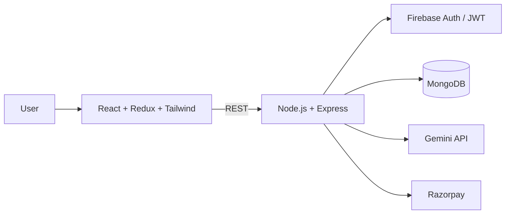

<div align="center">


<a href="https://git.io/typing-svg">
  
</a>

<br/>

[](https://www.linkedin.com/in/deepaksharma-0b74b631b)
[](mailto:deepakbagdadj@gmail.com)
[](#)


</div>

---

## 👨‍💻 `whoami`

```bash
$ whoami
deepak-sharma

$ cat profile.json
{
  "role"      : "Software Developer & ML Enthusiast",
  "education" : "B.E. Electronics & Communication, SVNIT Surat (2023 - 2027)",
  "location"  : "Jaipur, Rajasthan, India",
  "focus"     : ["Full-Stack Development", "AI-driven Applications", "DSA in C++"],
  "currently" : "Seeking Software Engineer / Full-Stack / SDE Intern roles",
  "mantra"    : "Build things that are scalable, useful and user-focused."
}
```

I'm a final-year ECE student at **NIT Surat** who prefers shipping software over talking about it. I build end-to-end web applications, from the database schema to the deployed UI, and I like working where **software engineering meets AI**. My recent work covers a production-ready AI SaaS platform and a hands-free voice assistant powered by the Google Gemini API.

---

## 🚀 Featured Projects

### 🎯 AI Interview Preparation Platform (SaaS)
> A production-ready, full-stack AI SaaS for interview prep, with authentication, payments and AI services built in.

| | |
|---|---|
| **What it does** | AI-assisted interview preparation for candidates |
| **Stack** | React.js, Redux, Tailwind CSS, Framer Motion, Node.js, Express.js, MongoDB, Mongoose |
| **AI** | Google Gemini API |
| **Auth** | Firebase Authentication + JWT |
| **Payments** | Razorpay |
| **Deployment** | Render |
| **Links** | [Live Demo](#) · [Source Code](#) <!-- TODO: add your real links --> |

**Engineering highlights**
- Designed the application architecture and REST API layer from scratch
- Implemented secure authentication and protected routes
- Integrated AI services into the core user flow
- Integrated payments and managed data with MongoDB
- Deployed and shipped as a real, usable product



---

### 🎙️ Hands-Free Voice Virtual Assistant
> A voice-driven assistant that listens, understands and responds, powered by the Google Gemini API.

| | |
|---|---|
| **What it does** | Hands-free, voice-first interaction with an AI assistant |
| **Stack** | JavaScript, Gemini API |
| **Links** | [Demo](#) · [Source Code](#) <!-- TODO: add your real links --> |

---

## 🛠️ Tech Arsenal

<div align="center">

**Languages**


**Frontend**


**Backend & Database**


**Tools & Platforms**


</div>

---

## 📊 GitHub Stats

<div align="center">


</div>

---

## 🧠 Core Strengths

| Area | What I bring |
|---|---|
| **Full-Stack Engineering** | MERN applications from idea to deployment |
| **API Design** | Clean REST APIs, authentication, authorization |
| **AI Integration** | Putting LLM capabilities (Gemini) into real product features |
| **DSA & CS Fundamentals** | Data Structures & Algorithms in C++, core CS concepts |
| **Product Mindset** | Scalable, user-focused software, not just working code |

---

## 🤝 Leadership & Community

- **Head of Data Management & Inventory**, Chintan Pratishthan Student Chapter, SVNIT: data organization and resource management
- **Coordinator, technical industrial visits**: connecting students with real industry and technology exposure

---

## 🎓 Education & Certifications

**Sardar Vallabhbhai National Institute of Technology (SVNIT), Surat**
B.E. in Electronics and Communication Engineering · *Aug 2023 – May 2027*

- 📜 Supervised Machine Learning: Regression and Classification
- 📜 AI Tools Workshop

---

## 🎯 What I'm Looking For

```diff
+ Software Engineer
+ Full-Stack Developer
+ Software Engineering Intern
```

I want to work on challenging problems, contribute to real-world products, and keep growing as an engineer. If you're building something meaningful, let's talk.

---

## 📬 Let's Connect

<div align="center">

[](https://www.linkedin.com/in/deepaksharma-0b74b631b)
[](mailto:deepakbagdadj@gmail.com)
[](https://github.com/u23ec179)

<br/>


*"Let's connect and build something meaningful."*


</div>
